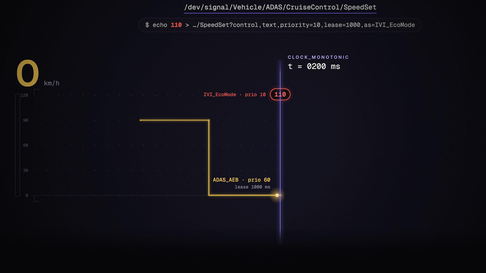
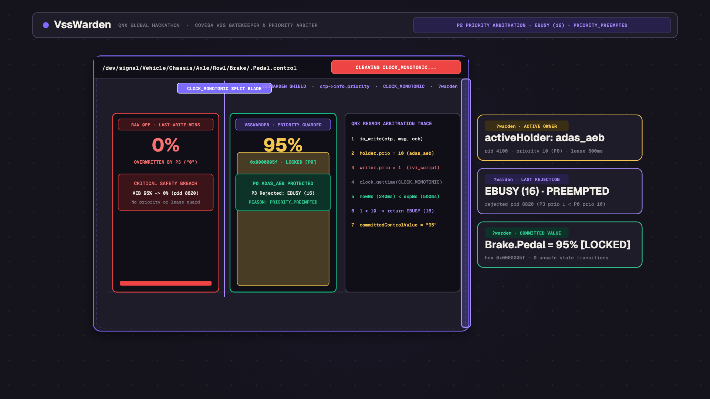
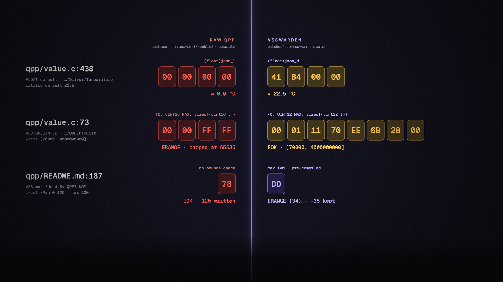
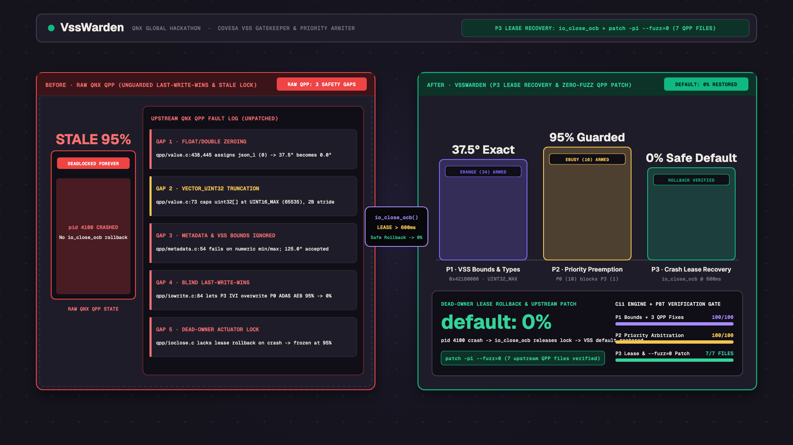
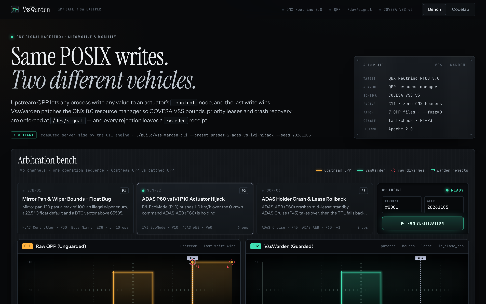
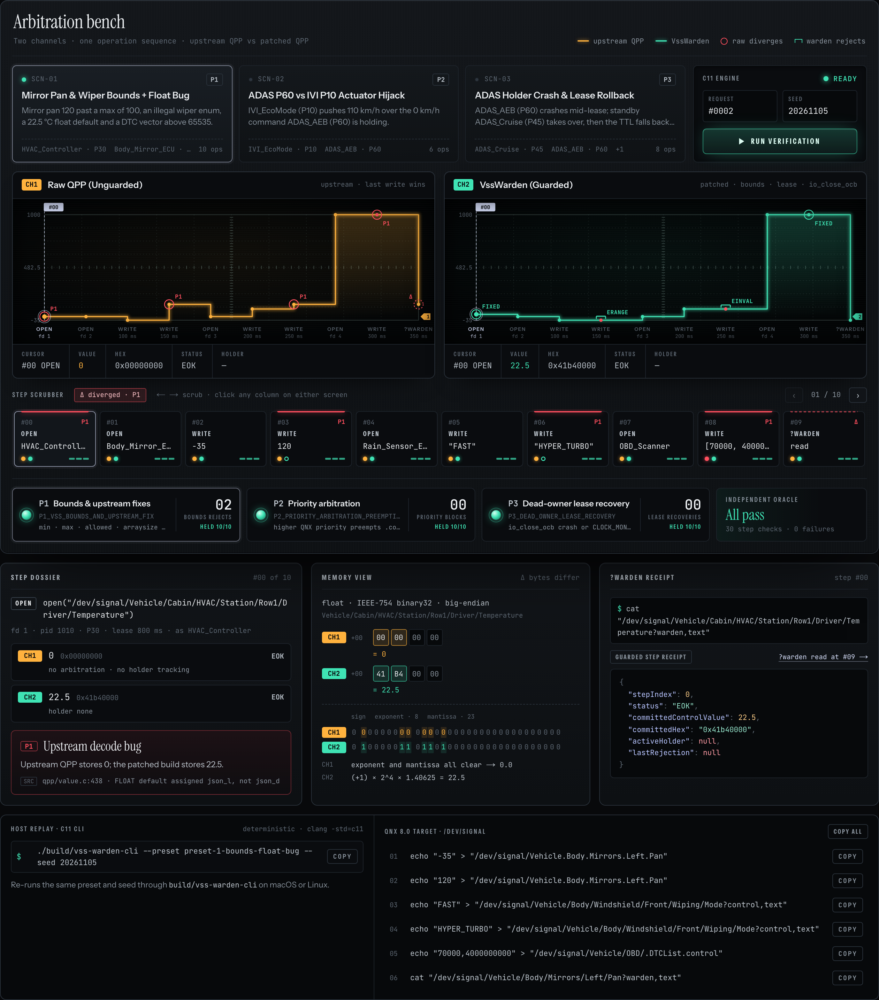
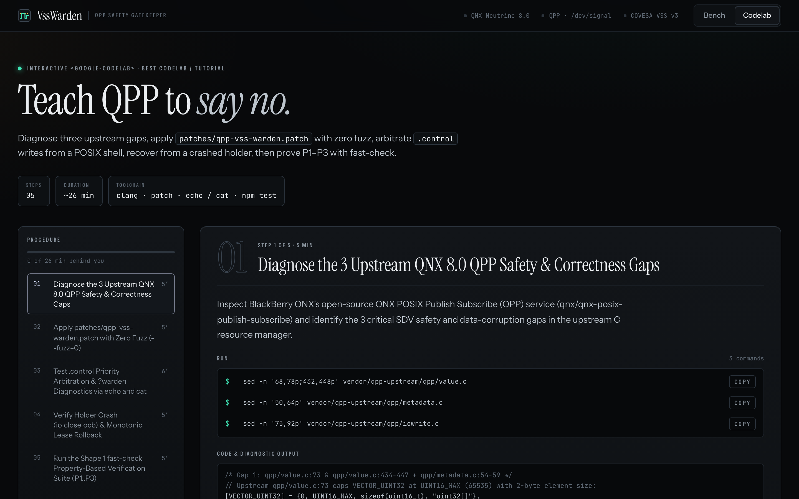
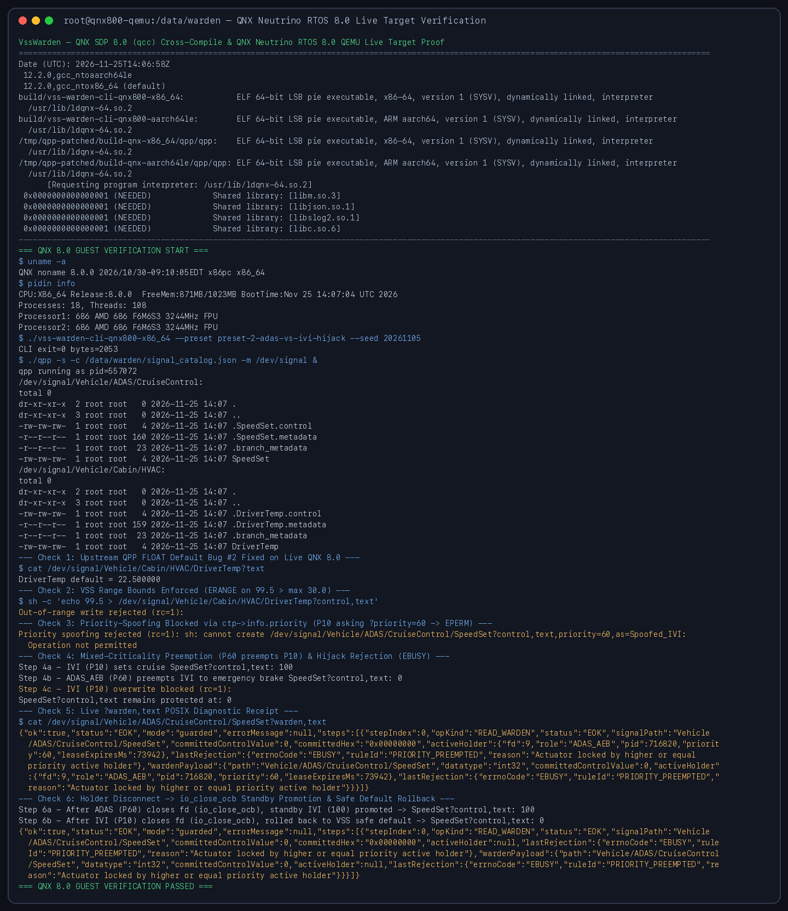

# VssWarden — Mixed-Criticality COVESA VSS Safety Gatekeeper & Verification Studio for QNX 8.0 QPP

`VssWarden` is an upstream-compatible C11 safety gatekeeper, priority-lease `.control` actuator arbiter, and property-based verification studio for BlackBerry QNX's publicly hosted [QNX POSIX Publish Subscribe (QPP)](https://github.com/qnx/qnx-posix-publish-subscribe) resource manager on QNX Neutrino RTOS 8.0.

**Target & Host Verification**: Cross-compiled with **QNX SDP 8.0** (`qcc` GCC 12.2.0) for both `x86_64` (`gcc_ntox86_64`) and `aarch64le` (`gcc_ntoaarch64le`) via both official QNX recursive `make` and `meson`, and verified live on **QNX Neutrino RTOS 8.0** (`QNX noname 8.0.0 x86pc x86_64` in QEMU via `mkqnximage`) mounting the patched `qpp` resource manager at `/dev/signal` — see [QNX SDP 8.0 Build Receipt](/docs/qnx800-verification/build-receipt.txt) and [QNX 8.0 QEMU Live Target Receipt](/docs/qnx800-verification/qemu-qnx800-target-run.txt). Host verification additionally covers Linux `json-c` integration and deterministic `fast-check` PBT (`P1..P3`). Physical automotive ECU hardware has not been tested; the 45s demo film shows the host Verification Studio, while the live QNX 8.0 QEMU target terminal proof is included below.

The Studio and API execute the same C source as a bundled WASI module (`runtimeEngine: "c11-wasi"`). They require Node.js, not a runtime C compiler or a macOS executable. QNX priority comes from the client context; a path modifier can lower that priority but cannot raise it above `ctp->info.priority`.

---

## QNX Global Hackathon Category & Bonus Prize Mapping

| Track / Prize | Target Category | How `VssWarden` Delivers |
| --- | --- | --- |
| **Primary Category** | **2. Automotive & Mobility** | Enforces COVESA Vehicle Signal Specification (VSS v3) `min`, `max`, `allowed`, and `arraysize` bounds at the QNX `QPP` resource-manager boundary (`ERANGE` / `EINVAL`) and arbitrates mixed-criticality ADAS vs. IVI `.control` actuator writes. |
| **Bonus Prize 1** | **Best Use of QNX-specific Technologies** | Hooks directly into QNX 8.0 `resmgr_attach` / `<sys/iofunc.h>` Open Control Block (`io_close_ocb`) lifecycle callbacks, client priority (`ctp->info.priority` / `pid`), `CLOCK_MONOTONIC` lease timers, and a zero-SDK `?warden` POSIX path modifier (`OP_MODE_WARDEN`). |
| **Bonus Prize 2** | **Best Codelab / Tutorial** | Ships a built-in interactive `<google-codelab>` tutorial at `/codelab` ([app/codelab/page.tsx](/app/codelab/page.tsx)) walking developers step-by-step through the 3 upstream `QPP` gaps, zero-fuzz patching, POSIX `echo`/`cat ?warden,text` arbitration, and `fast-check` property-based verification. |

---

## Demo Video & Visual Walkthrough

- **45-Second Narrated Launch & Technical Demo Video (`1080p30`, 180° shutter motion blur, Kokoro VO + bilingual EN/ZH-TW subtitles)**: [docs/media/vss-warden-demo.mp4](/docs/media/vss-warden-demo.mp4)
- **12-Frame Contact Sheet**: [docs/media/stills.png](/docs/media/stills.png)

| Beat 1 — POSIX `.control` Collision Hook (`t = 9.20s`) | Beat 2 — Split-Timeline Priority Preemption (`t = 19.45s`) |
| --- | --- |
|  |  |
| **Beat 3 — Upstream `QPP` 3-Bug Hex Probe (`t = 27.05s`)** | **Beat 4 — Crash / TTL Lease Recovery (`t = 33.75s`)** |
|  |  |

### Web UI — Two-Channel Arbitration Bench (`/`) & Interactive Codelab (`/codelab`)

| Two-Channel Arbitration Bench (`/`) | IEEE-754 Binary32 & `?warden` Inspector (`/`) | Interactive `<google-codelab>` Workshop (`/codelab`) |
| --- | --- | --- |
|  |  |  |

### Live QNX Neutrino RTOS 8.0 Target Proof (`qcc` Dual-Arch + QEMU `/dev/signal` Execution)



---

## The 3 Upstream QNX `QPP` Safety & Correctness Gaps Fixed by `VssWarden`

Inspecting the upstream `qnx/qnx-posix-publish-subscribe` (`qpp/`) source code reveals three critical gaps when running mixed-criticality Software-Defined Vehicle (SDV) workloads:

1. **Unenforced COVESA VSS Bounds & 3 Upstream Value/Metadata Bugs**:
   - `qpp/README.md` (`lines 187–199`): Marks the COVESA VSS attributes `min`, `max`, `allowed`, and `arraysize` as `Used By QPP? NO`.
   - `qpp/value.c` (`line 73`): Defines `[VECTOR_UINT32] = {0, UINT16_MAX, sizeof(uint16_t), "uint32[]"}`, erroneously capping 32-bit unsigned vectors at `65535` with a 2-byte element size instead of `UINT32_MAX` and `sizeof(uint32_t)`.
   - `qpp/value.c` (`lines 434–447`, specifically `line 438` for `FLOAT` and `line 445` for `DOUBLE`): Decodes JSON floating-point defaults into `json_d` via `json_decoder_get_double()`, but assigns the zero-initialized integer `json_l` (`0`), silently corrupting every non-zero `FLOAT`/`DOUBLE` catalog default (such as `22.5` °C HVAC temperature) to `0.0`.
   - `qpp/metadata.c` (`lines 54–59`): Calls `json_decoder_get_string()` on all metadata properties, causing queries for numeric `min`/`max` or array `allowed` attributes to fail with `EINVAL`.
2. **Blind Last-Write-Wins on `.control` Actuators (`Actuator Hijack`)**:
   - `qpp/README.md` (`line 224`), `qpp/iowrite.c` (`lines 78–90`), and `qpp/iowrite_text.c` (`lines 112–124`): Concurrent writes to an actuator's `.control` node unconditionally overwrite the previous request. A low-priority Infotainment script (`Priority P10`) can immediately overwrite an active emergency command from ADAS Automatic Emergency Braking (`Priority P60`).
3. **No Crash / Disconnect Lease Recovery (`io_close_ocb`) or POSIX Rejection Diagnostics (`?warden`)**:
   - `qpp/ioclose.c`, `qpp/ioopen.c`, and `qpp/main.c` (`line 160`): When a high-priority holder crashes or disconnects without releasing an actuator lock, a naive lock permanently deadlocks the actuator unless tied to `io_close_ocb` cleanup and `CLOCK_MONOTONIC` lease expiry with standby promotion or VSS `default` safe-state rollback. Furthermore, rejected POSIX writes return `-1` without structured diagnostics explaining which rule or higher-priority owner blocked the actuation.

---

## Repository Architecture

- [src/c/vss_warden_core.h](/src/c/vss_warden_core.h) & [src/c/vss_warden_core.c](/src/c/vss_warden_core.c): Portable C11 safety engine (`libvsswarden_core`) with zero QNX header dependencies, implementing comment stripping for `signal_catalog.json`, VSS constraint pre-compilation, priority-lease `.control` arbitration, `io_close_ocb` / `CLOCK_MONOTONIC` rollback, and `?warden` JSON diagnostics.
- [src/c/vss_warden_cli.c](/src/c/vss_warden_cli.c): Native C11 CLI runner supporting both `--preset <id> --seed <n>` deterministic replay and persistent JSON batch verification.
- [patches/qpp-vss-warden.patch](/patches/qpp-vss-warden.patch): Unified diff for 14 original upstream files (`common.mk`, `meson.build`, `node.{c,h}`, `ocb.h`, catalog, open, both read/write paths, close, value and metadata). [scripts/apply-qpp-patch.sh](/scripts/apply-qpp-patch.sh) checks the pinned base, applies with zero fuzz, and copies the core plus [QPP adapter](/src/c/qpp_warden.c).
- [scripts/verify-qnx800-target.sh](/scripts/verify-qnx800-target.sh) & [docs/qnx800-verification/](/docs/qnx800-verification/qemu-qnx800-target-run.txt): End-to-end QNX SDP 8.0 (`qcc` / `make` / `meson`) dual-architecture build and headless QEMU QNX Neutrino RTOS 8.0 target verification harness and captured receipts.
- [lib/oracle.ts](/lib/oracle.ts) & [tests/warden-core-pbt.test.ts](/tests/warden-core-pbt.test.ts): Independent TypeScript state-machine oracle and Shape 1 `fast-check` Property-Based Testing suite (`P1..P3`).
- [app/page.tsx](/app/page.tsx) & [lib/studio-model.ts](/lib/studio-model.ts): Side-by-Side SDV Verification Studio (`Raw QPP (Unguarded)` vs. `VssWarden (Guarded)`) with race-safe `studioReducer` (`activeRequestId`) and clamped SVG timelines.
- [app/codelab/page.tsx](/app/codelab/page.tsx): Interactive step-by-step QNX 8.0 `<google-codelab>` tutorial.

---

## Reproducible Build & Verification Instructions

### 1. Host Build & Verification (macOS / Linux — Zero External API Keys)

Requirements: Node.js 22+, `clang` (C11), Git, `patch`, and network access to the official QNX GitHub repository for patch verification. `npm test` fetches the pinned upstream source into a temporary directory and removes it after verification; fetch failures fail the test.

```bash
# 1. Install dependencies
npm install

# 2. Compile the portable C11 engine and CLI binary via clang
npm run build:c
# Executes the C11 build with -lm; presets are generated from lib/presets.ts.

# 3. Run the complete test suite (Shape 1 fast-check PBT P1..P3 + patch --fuzz=0 gate + Studio/Codelab tests)
npm test

# 4. Run TypeScript typechecking and Next.js production build
npm run typecheck
npm run build

# 5. Start the Side-by-Side Verification Studio & Interactive Codelab on http://localhost:3000
npm run dev
```

Replay any preset deterministically from the terminal in one line. `--seed` drives an unsigned 32-bit LCG and adds reproducible 10–50 ms timing increments to timed operations. Different seeds change actual lease-expiry timestamps. The API uses the same generator and the CLI presets are generated from [lib/presets.ts](/lib/presets.ts):

```bash
./build/vss-warden-cli --preset preset-1-bounds-float-bug --seed 20261105
./build/vss-warden-cli --preset preset-2-adas-vs-ivi-hijack --seed 20261105
./build/vss-warden-cli --preset preset-3-crash-lease-rollback --seed 20261105
```

### 2. QNX Neutrino RTOS 8.0 Target Build (Verified — `x86_64` & `aarch64le`)

Use a licensed QNX SDP 8.0 Linux x86_64 host with `qnxsdp-env.sh`, GNU `make`, and (optionally) Meson `>= 1.10` + Ninja. The [official qcc reference](https://www.qnx.com/developers/docs/8.0/com.qnx.doc.neutrino.utilities/topic/q/qcc.html) lists `gcc_ntoaarch64le` and `gcc_ntox86_64` for C. Full compiler and ELF `NEEDED` output (`ldqnx-64.so.2`, `libm.so.3`, `libjson.so.1`, `libslog2.so.1`, `libc.so.6`) is recorded in [docs/qnx800-verification/build-receipt.txt](/docs/qnx800-verification/build-receipt.txt).

From the `VssWarden` checkout:

```bash
source ~/qnx800/qnxsdp-env.sh
bash scripts/apply-qpp-patch.sh .scratch/qpp-patched
mkdir -p build

# 1. Cross-compile the standalone VssWarden C11 CLI for QNX 8.0 (x86_64 & aarch64le)
qcc -Vgcc_ntox86_64 -std=c11 -O2 -Wall -Wextra src/c/vss_warden_core.c src/c/vss_warden_cli.c -lm -o build/vss-warden-cli-qnx800-x86_64
qcc -Vgcc_ntoaarch64le -std=c11 -O2 -Wall -Wextra src/c/vss_warden_core.c src/c/vss_warden_cli.c -lm -o build/vss-warden-cli-qnx800-aarch64le

# 2a. Build patched QPP via upstream's official QNX SDP recursive Makefile (builds both nto/x86_64 and nto/aarch64)
(cd .scratch/qpp-patched && make)
```

To also cross-compile via Meson (`>= 1.10`), create `.scratch/qpp-patched/qnx-x86_64.ini` (and `qnx-aarch64le.ini` with `ntoaarch64-gcc` + `-mlittle-endian` + `aarch64le` paths; expand `${QNX_TARGET}` to your SDP target path):

```ini
[binaries]
c = 'ntox86_64-gcc'
ar = 'ntox86_64-ar'
strip = 'ntox86_64-strip'
[built-in options]
c_args = ['--sysroot=/path/to/qnx800/target/qnx', '-B/path/to/qnx800/target/qnx/x86_64/lib', '-B/path/to/qnx800/target/qnx/x86_64/usr/lib', '-I/path/to/qnx800/target/qnx/usr/include', '-D__QNXNTO__']
c_link_args = ['--sysroot=/path/to/qnx800/target/qnx', '-L/path/to/qnx800/target/qnx/x86_64/lib', '-L/path/to/qnx800/target/qnx/x86_64/usr/lib', '-Wl,--rpath-link,/path/to/qnx800/target/qnx/x86_64/lib', '-Wl,--rpath-link,/path/to/qnx800/target/qnx/x86_64/usr/lib']
[host_machine]
system = 'qnx'
cpu_family = 'x86_64'
cpu = 'x86_64'
endian = 'little'
```

```bash
meson setup .scratch/qpp-patched/build-qnx-x86_64 .scratch/qpp-patched --cross-file .scratch/qpp-patched/qnx-x86_64.ini
meson compile -C .scratch/qpp-patched/build-qnx-x86_64
```

The apply helper downloads official commit `b5ca892f37464bea4ff88db3fdbbb2cc651da6a8` when the destination does not exist, checks the exact revision, then applies the patch. A failed download is an error, not a skipped verification.

### 3. QEMU QNX 8.0 Boot, Mount and Live Verification (Verified)

On the SDP Linux host, use the [official mkqnximage utility](https://www.qnx.com/developers/docs/8.0/com.qnx.doc.neutrino.utilities/topic/m/mkqnximage.html) with QEMU installed (or run [scripts/verify-qnx800-target.sh](/scripts/verify-qnx800-target.sh) for automated headless execution; captured guest session in [docs/qnx800-verification/qemu-qnx800-target-run.txt](/docs/qnx800-verification/qemu-qnx800-target-run.txt) and [docs/qnx800-verification/qnx800-cli-preset2.json](/docs/qnx800-verification/qnx800-cli-preset2.json)):

```bash
mkdir -p qnx-vm
cd qnx-vm
mkqnximage --type=qemu --arch=x86_64 --build
mkqnximage --run
mkqnximage --getip
```

Copy `.scratch/qpp-patched/build-qnx-x86_64/qpp/qpp` (or `.scratch/qpp-patched/qpp/nto/x86_64/o/qpp`), `build/vss-warden-cli-qnx800-x86_64`, and a supported catalog into `/data/warden` via `scp` (or `local/snippets/data_files.custom` if running without a host tap bridge; bundle `libjson.so.1` from `$QNX_TARGET/x86_64/lib` into `LD_LIBRARY_PATH` if your base image omits it). On the QNX 8.0 guest, stop any stock `qpp` instance, mount the patched resource manager at `/dev/signal`, and run the CLI:

```bash
slay -f qpp 2>/dev/null || true
chmod +x ./qpp ./vss-warden-cli-qnx800-x86_64
./qpp -s -c ./signal_catalog.json -m /dev/signal &
./vss-warden-cli-qnx800-x86_64 --preset preset-2-adas-vs-ivi-hijack --seed 20261105
```

For the live mixed-criticality shell verification below, use a catalog containing `Vehicle/ADAS/CruiseControl/SpeedSet` (`int32`, min 0, max 130, default 0). In separate guest consoles start `on -p60 sh` for ADAS and `on -p10 sh` for IVI. Keep ADAS fd 3 open; a one-shot shell redirection closes its OCB and immediately releases its lease:

```bash
# Priority-spoofing check (P10 asking ?priority=60 -> rejected with EPERM / Operation not permitted):
on -p10 sh -c 'echo "80" > "/dev/signal/Vehicle/ADAS/CruiseControl/SpeedSet?control,text,priority=60,as=Spoofed_IVI"'

# ADAS shell (P60):
exec 3>"/dev/signal/Vehicle/ADAS/CruiseControl/SpeedSet?control,text,priority=60,lease=60000,as=ADAS_AEB"
echo "0" >&3
# IVI shell (P10), while ADAS fd 3 stays open (rejected with EBUSY; ?control,text stays 0):
echo "110" > "/dev/signal/Vehicle/ADAS/CruiseControl/SpeedSet?control,text,priority=10,as=IVI_EcoMode"
cat "/dev/signal/Vehicle/ADAS/CruiseControl/SpeedSet?control,text"
cat "/dev/signal/Vehicle/ADAS/CruiseControl/SpeedSet?warden,text"
# ADAS shell: release the lease (io_close_ocb promotes standby IVI or restores VSS safe default 0):
exec 3>&-
```

Verified live on `QNX noname 8.0.0 2026/10/30-09:10:05EDT x86pc x86_64`: `FLOAT` default `22.5` loads as `22.500000`, out-of-range write `99.5` fails with `ERANGE`, priority spoofing fails with `Operation not permitted` (`EPERM`), low-priority `IVI` overwrite fails with `EBUSY` while `ADAS_AEB` (`pid 716820`, `priority 60`) holds `0`, `?warden,text` emits the structured JSON receipt, and closing `ADAS` + `IVI` descriptors triggers `io_close_ocb` standby promotion (`100`) followed by safe default rollback (`0`). `CLOCK_MONOTONIC` expiry is evaluated on the next read/write/close; this patch does not schedule an idle hardware actuation timer.

### 4. Host QPP integration and Serverless runtime

The [host integration fixture](/tests/qpp-host/meson.build) compiles the patched upstream catalog, node/tree, open, text/binary read/write, close and value/metadata sources. It uses `json-c` plus test-only QNX message compatibility headers. With Git, `patch`, network access, `libjson-c-dev`, Meson and Ninja installed on Linux, this command fetches the official fixed revision, applies the patch, builds and tests the handlers, then removes the temporary checkout and build:

```bash
npm run test:qpp-host
```

The default web path executes [runtime/vss-warden.wasm](/runtime/vss-warden.wasm) through Node's WASI preview1 runtime and only writes temporary stdin/stdout files under the OS temp directory. [next.config.ts](/next.config.ts) includes both runtime files in the API function. `npm run build` needs no C compiler. Native tests still use `npm run build:c`; if the C source or presets change, regenerate the bundled module with the [official WASI SDK](https://github.com/WebAssembly/wasi-sdk):

```bash
WASI_SDK_PATH=/path/to/wasi-sdk bash scripts/build-wasi.sh
```

WASI preview1 emits Node's experimental-feature warning. This is host verification of the C engine, not QNX scheduling or resource-manager kernel behavior. Supported guarded data types are the numeric scalars, `string`, and `uint32[]` represented by the core header; unsupported catalog types fail initialization rather than silently bypassing protection.

---

## License

Licensed under the Apache License, Version 2.0. See [LICENSE](/LICENSE) and [NOTICE](/NOTICE) for attribution and scope. The original code in this project is Apache-2.0; upstream QPP at `b5ca892f` carries BlackBerry Limited proprietary-rights notices requiring an express license agreement. This license does not relicense QPP or grant rights to its code. Upstream source snapshots are not bundled; scripts fetch the fixed official revision into temporary or ignored local checkouts.
